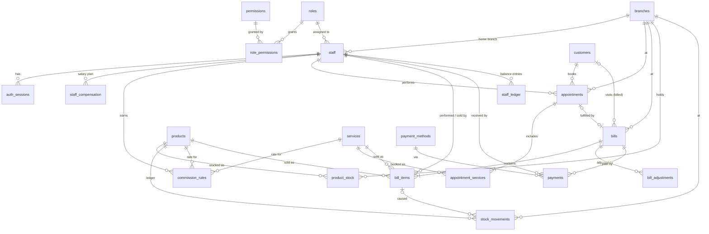

# Database Design — Barber Salon Management System

> **Status:** DRAFT v0.3 (Phase 1 — owner answers Q1–Q8 and R-Q1–R-Q3 applied; pending final approval).
> Schema will be created via Kysely migrations (`server/src/db/migrations`), never by hand.
> Target: PostgreSQL 16. Extensions: `btree_gist` (booking / effective-date exclusion constraints), `pg_trgm` (customer name search).

### Changes from v0.2
- **Advances & repayment:** `staff_ledger.entry_type` gains `REPAYMENT` (staff pays back an advance) and `ROUND_OFF`.
- **Daily staff settlement rounding:** payout rounded **up** to `settings.payout_round_off_unit` (default ₹10); the difference is a `ROUND_OFF` credit so the ledger always balances.
- **Customer bill rounding:** `bills.round_off_amount` (signed); final bill rounded to `settings.bill_round_off_unit` (default ₹10) — last digit 1–5 down, 6–9 up. Not allocated to lines → does not change staff commission.
- No new tables (still 21).

### Changes from v0.1
- **Branch-ready** (Q1): `branches` table added; branch-specific data carries `branch_id`; stock moved to `product_stock` (per branch). One branch is seeded; UI hides branch selection while only one exists.
- **Product commission** (Q2): `commission_rules` now covers services *and* products.
- **Staff balance & withdrawals** (Q3): `staff_payouts` + `bill_items.payout_id` replaced by `staff_ledger` (running balance; withdrawals entered by staff or manager and confirmed by the other party).
- **Fixed salary + product commission** (Q4): plan types removed — compensation is "optional fixed monthly salary" + "whatever commission rules are configured". No rule ⇒ no commission.
- **Booking gap** (Q6): `appointments.blocked_until` = end + configurable rest buffer (default 10 min).
- **Extra discount after billing** (Q6): `bill_adjustments` table; commission is re-balanced on affected lines.

---

## 1. Entity analysis

| Requirement | Entity | Notes |
|---|---|---|
| Salon / future branches | `branches` | Name, address, timezone, invoice prefix + counter per branch. |
| Global config | `settings` | Single row, typed columns. |
| Managers, staff, login, activation | `staff` | One table. Login fields nullable — an employee who never logs in is still a staff record. |
| Flexible permissions | `roles`, `permissions`, `role_permissions` | Permission keys seeded by migration; managers compose roles. |
| Secure sessions | `auth_sessions` | Hashed, rotating refresh tokens. |
| Customers | `customers` | Shared across branches. |
| Services & prices | `services` | Current price only; history lives in bill snapshots. |
| Products & stock | `products`, `product_stock`, `stock_movements` | Catalogue global; stock per branch; movement ledger immutable. |
| Compensation | `staff_compensation`, `commission_rules` | Effective-dated. |
| Appointments | `appointments`, `appointment_services` | Separate from billing; never revenue. |
| Visits / bills | `bills` | **A finalised bill *is* the customer visit** — no `visits` table. |
| Bill line items | `bill_items` | Services + products; all price & commission **snapshots**. |
| Post-billing discounts | `bill_adjustments` | Who gave what extra discount, when, why. |
| Payments | `payment_methods`, `payments` | Multiple + partial per bill. |
| Staff earnings / withdrawals | `staff_ledger` | Salary credits, withdrawals, advances, adjustments. Commission itself is **not** copied here — it is read from `bill_items`. |

**Total: 21 tables.** Deliberately *not* created: `visits` (= bills), `commission_entries`
(= snapshot columns on `bill_items`), `service_sales`/`product_sales` (= `bill_items` by type),
price-history tables (= bill snapshots), staff balance table (= derived from ledger + bill_items).

---

## 2. ER diagram



---

## 3. Conventions

- Primary keys: `id BIGINT GENERATED ALWAYS AS IDENTITY`. Invoices use the human `invoice_no`.
- Money `NUMERIC(12,2)`; rates `NUMERIC(5,2) CHECK (0..100)`; quantities `INTEGER`.
- Time: `TIMESTAMPTZ` (stored UTC); "today"/"this month" computed in the branch timezone.
- Mutable tables: `created_at`, `updated_at`; editable masters also `version INT` (optimistic locking → 409 on stale edit).
- Soft deactivation (`is_active`) for staff, services, products, payment methods, branches. All FKs to historical data are `ON DELETE RESTRICT`.
- Status/type columns: `TEXT` + `CHECK (… IN (…))`.

---

## 4. Tables

### 4.1 Organisation & config

**`branches`**
| id | name | address | phone | timezone (`Asia/Kolkata`) | invoice_prefix (UNIQUE, e.g. `MAIN`) | next_invoice_no bigint | is_active | version, timestamps |

**`settings`** (single row, `id smallint PK CHECK (id = 1)`)
| currency_code (`INR`) | allow_negative_stock bool (false) | appointment_buffer_minutes int (10, CHECK 0–60) | bill_round_off_unit numeric (10; CHECK IN 0,1,5,10 — 0 = off) | payout_round_off_unit numeric (10; same CHECK) | tax_enabled bool (false) | tax_rate_pct | prices_include_tax bool | updated_at |

### 4.2 Access control

**`permissions`** — `id smallint PK`, `key text UNIQUE` (e.g. `billing.create`), `description`.
**`roles`** — `id`, `name UNIQUE`, `description`, `is_system` (protects built-in Manager), timestamps.
**`role_permissions`** — PK `(role_id, permission_id)`.

**`staff`**
| Column | Type | Constraints / purpose |
|---|---|---|
| id | bigint | PK |
| branch_id | bigint | FK branches (home branch) |
| full_name | text | NOT NULL |
| mobile / email | text | UNIQUE, nullable |
| username | text | UNIQUE nullable — NULL ⇒ cannot log in (login optional, Q7) |
| password_hash | text | argon2id; CHECK (username IS NULL) = (password_hash IS NULL) |
| role_id | bigint | FK roles |
| is_active | boolean | deactivation revokes all sessions |
| performs_services | boolean | can be assigned services (managers optional, Q7) |
| joined_on | date | |
| version, timestamps | | |

**`auth_sessions`** — `id`, `staff_id` FK, `refresh_token_hash` UNIQUE, `family_id uuid` (rotation / reuse detection), `expires_at`, `revoked_at`, `device_label`, `created_at`. Index `(staff_id) WHERE revoked_at IS NULL`.

### 4.3 Customers

**`customers`** — `id` (Customer ID), `full_name` NOT NULL, `mobile` NOT NULL UNIQUE (normalised), `email`, `address`, `notes`, `registered_at`, version, timestamps.
Indexes: UNIQUE `mobile` (prefix search), GIN trigram on `full_name`.
Lifetime visits/spend are computed from `bills` (indexed), not stored.

### 4.4 Catalogue & inventory

**`services`** *(migration `0003_services`, 2026-11-26)* — `id`, `name` (not blank), `category` text nullable (free text, suggested from values in use), `description` nullable, `price` numeric(12,2) CHECK ≥ 0, `duration_minutes` int CHECK 1–600, `is_active`, version, timestamps. Partial UNIQUE `(lower(name)) WHERE is_active`; index `(lower(category))`. "Haircut + Beard" is its own service row (own price, own commission rate). Bills will copy name and price at the time of sale, so price changes never alter history. (`sort_order` from the draft was dropped — the list is ordered by category, then name.)

*Implemented in migration `0002_inventory` (2026-11-24). Pricing follows the owner's rule: a product has an **MRP** and a **default discount %**; the **selling price = MRP − discount** is computed (never stored), e.g. MRP 2000.00 at 10 % → 1800.00. Each delivery's **buying price lives only on its PURCHASE movement**, so there is no single "purchase price" on the product; the API reports the latest delivery's price as `lastPurchasePrice`.*

**`products`**
| Column | Type | Constraints / purpose |
|---|---|---|
| id | bigint | PK |
| name | text | NOT NULL, not blank |
| brand | text | nullable |
| category | text | nullable, free text (suggested from values already used; no category table) |
| mrp | numeric(12,2) | CHECK > 0 |
| default_discount_pct | numeric(5,2) | CHECK 0–100, default 0 |
| is_active | boolean | |
| version, timestamps | | |

Indexes: partial UNIQUE `(lower(name), lower(coalesce(brand,''))) WHERE is_active` — the same product can't be listed twice while active; GIN trigram on `name`; `(lower(category))`.

**`product_stock`** — per-branch balance
| branch_id FK | product_id FK | quantity int | low_stock_threshold int CHECK ≥ 0 | version | updated_at |
PK `(branch_id, product_id)`. CHECK `quantity >= 0` is **not** declared (negative stock is a setting); the service layer enforces it under a row lock (`SELECT … FOR UPDATE`) inside the same transaction that writes the ledger.
Partial index `(branch_id) WHERE quantity <= low_stock_threshold` for low-stock alerts.

**`stock_movements`** — immutable ledger; `quantity` always equals the sum of `quantity_delta`
| id | branch_id FK | product_id FK | movement_type CHECK IN (`PURCHASE`,`SALE`,`ADJUSTMENT`,`SALE_REVERSAL`) | quantity_delta int CHECK ≠ 0 | unit_cost numeric(12,2) ≥ 0 | supplier_name | supplier_invoice_no | reason | note | created_by FK staff | created_at |
CHECKs: PURCHASE ⇒ `quantity_delta > 0` and `unit_cost` set; ADJUSTMENT ⇒ `reason` set (`DAMAGED`, `EXPIRED`, `USED_IN_SALON`, `COUNT_CORRECTION`, `RETURNED_TO_SUPPLIER`, `OTHER` — checked by the API).
`bill_item_id` (for SALE / SALE_REVERSAL) is added by the billing migration.
Indexes: `(branch_id, product_id, id DESC)` for history paging; partial `(product_id, id DESC) WHERE movement_type = 'PURCHASE'` for the latest buying price.

### 4.5 Compensation

Built in migration `0004_compensation` (owner decision 2026-11-24, replacing the earlier per-type staff default draft).

**`settings.default_commission_pct`** numeric(5,2), CHECK 0–100, default 0 — the one salon-wide default rate.

**`staff_compensation`** — effective-dated monthly salary (a row exists only while the employee is salaried)
| Column | Type | Constraints |
|---|---|---|
| id | bigint | PK |
| staff_id | bigint | FK staff |
| monthly_salary | numeric(12,2) | CHECK > 0 (no row = commission-based) |
| effective_from / effective_to | timestamptz | `effective_to` null = current; CHECK to > from |
| created_by, created_at | | |

`EXCLUDE USING gist (staff_id WITH =, tstzrange(effective_from, effective_to) WITH &&)` — never two salaries at once; unique current row per staff.

**`commission_rules`** — effective-dated own rate of one employee for one item
| Column | Type | Constraints |
|---|---|---|
| id | bigint | PK |
| staff_id | bigint | FK staff |
| item_type | text | CHECK IN (`SERVICE`,`PRODUCT`) |
| service_id | bigint | FK services; required when SERVICE |
| product_id | bigint | FK products; required when PRODUCT |
| rate_pct | numeric(5,2) | CHECK 0–100 |
| effective_from / effective_to | timestamptz | `effective_to` null = current |
| created_by, created_at | | |

CHECK: exactly the matching item column is set. Unique current rule per `(staff_id, item_type, COALESCE(service_id, product_id)) WHERE effective_to IS NULL`.
Changing a salary or rate closes the current row (`effective_to` = now) and inserts a new one, so past bills can always be explained. Saves lock the employee row first and take the time after the lock.

**Which rate applies** (`server/src/modules/compensation/commission.calculator.ts`, the only place):
1. the employee's own rate for that service/product, else
2. if the employee has **no** monthly salary → the salon default, else
3. no commission.

Example: salon default 10 %. Rahul (commission-based) — Haircut 40 %, everything else 10 %. Vikram (salary ₹15,000) — Beard Oil 5 %, nothing on other items.

**`staff_ledger`** — everything that changes a staff member's balance *except* commission (which is read from `bill_items`)
| Column | Type | Constraints / purpose |
|---|---|---|
| id | bigint | PK |
| staff_id | bigint | FK staff |
| branch_id | bigint | FK branches |
| entry_type | text | CHECK IN (`SALARY_CREDIT`,`WITHDRAWAL`,`REPAYMENT`,`ROUND_OFF`,`ADJUSTMENT`) |
| amount | numeric(12,2) | signed: credits + (salary, repayment, round-off), withdrawals − ; CHECK ≠ 0 |
| settlement_group | uuid | nullable — ties a daily payout WITHDRAWAL to its ROUND_OFF entry (confirmed/rejected together) |
| salary_month | date | first of month; required for SALARY_CREDIT; UNIQUE `(staff_id, salary_month) WHERE entry_type='SALARY_CREDIT'` — salary can never be posted twice |
| payment_method_id | bigint | FK nullable (how the withdrawal was paid: cash/UPI) |
| status | text | CHECK IN (`PENDING`,`CONFIRMED`,`REJECTED`) |
| entered_by | bigint | FK staff |
| confirmed_by / confirmed_at | | nullable; CHECK confirmed_by ≠ entered_by |
| note | text | |
| idempotency_key | uuid | UNIQUE |
| created_at | timestamptz | |

**Balance** (computed, never stored):
```
earned_commission = Σ bill_items.commission_amount   (staff_id = X, bill FINALIZED)
ledger_total      = Σ staff_ledger.amount            (staff_id = X, status CONFIRMED)
available_balance = earned_commission + ledger_total
pending_requests  = Σ staff_ledger.amount            (status PENDING)
```
Indexes: `(staff_id, created_at DESC)`, partial `(staff_id) WHERE status = 'PENDING'`.

Balance may go **negative** (advance) — allowed because every withdrawal needs the manager on one
side (enterer or confirmer). It is recovered automatically from future commission, or by a `REPAYMENT`.
Staff without a login: entries made by the manager are auto-confirmed (no second party exists).

Daily settlement example: balance ₹113 → payout rounded up to ₹120 → entries `ROUND_OFF +7` and
`WITHDRAWAL −120` in one `settlement_group` → balance 0.

### 4.6 Appointments

**`appointments`**
| Column | Type | Constraints |
|---|---|---|
| id | bigint | PK |
| branch_id | bigint | FK |
| customer_id | bigint | FK customers |
| staff_id | bigint | FK staff |
| starts_at / ends_at | timestamptz | CHECK ends_at > starts_at |
| blocked_until | timestamptz | = ends_at + buffer **at booking time** (snapshot, so changing the setting doesn't invalidate existing bookings) |
| status | text | `SCHEDULED`,`CONFIRMED`,`IN_PROGRESS`,`COMPLETED`,`CANCELLED`,`NO_SHOW` |
| notes, created_by, version, timestamps | | |

```sql
EXCLUDE USING gist (staff_id WITH =, tstzrange(starts_at, blocked_until, '[)') WITH &&)
  WHERE (status IN ('SCHEDULED','CONFIRMED','IN_PROGRESS'))
```
→ back-to-back bookings automatically keep the rest gap. Indexes `(branch_id, starts_at)`, `(staff_id, starts_at)`, `(customer_id, starts_at DESC)`.

**`appointment_services`** — PK `(appointment_id, service_id)`; `ends_at` defaults to start + Σ durations.

### 4.7 Billing & payments

**`bills`** (= customer visit)
| Column | Type | Constraints |
|---|---|---|
| id | bigint | PK |
| branch_id | bigint | FK |
| invoice_no | text | UNIQUE, `<prefix>-<year>-<seq>` (gapless per branch) |
| idempotency_key | uuid | UNIQUE |
| customer_id | bigint | FK nullable — walk-in without details allowed; UI asks for mobile first |
| appointment_id | bigint | FK UNIQUE nullable |
| status | text | `FINALIZED`,`VOIDED` |
| subtotal | numeric | Σ line gross |
| discount_total | numeric | item + bill-level + extra discounts |
| tax_total | numeric | 0 until tax enabled |
| round_off_amount | numeric | signed; CHECK between −5 and +5 (half the unit, enforced in service for other units); e.g. ₹525 → −5 → ₹520, ₹527 → +3 → ₹530 |
| grand_total | numeric | subtotal − discount_total + tax_total + round_off_amount |
| paid_total | numeric | CHECK 0 ≤ paid_total ≤ grand_total |
| billed_at, created_by | | |
| voided_at, voided_by, void_reason | | nullable |
| version | int | |

Outstanding and payment status (unpaid/partial/paid) are derived.
Indexes: `(customer_id, billed_at DESC)`, `(branch_id, billed_at)`, partial `(branch_id) WHERE status='FINALIZED' AND paid_total < grand_total`.

**`bill_items`**
| Column | Type | Purpose |
|---|---|---|
| id, bill_id | | |
| item_type | text | `SERVICE` / `PRODUCT`; CHECK matches exactly one of service_id / product_id |
| service_id / product_id | FK | |
| item_name | text | **snapshot** |
| staff_id | FK | performer (required for SERVICE) / seller (optional for PRODUCT; no seller ⇒ no commission) |
| quantity | int | CHECK > 0 |
| unit_price | numeric | **snapshot** |
| unit_cost | numeric | **snapshot** (products; for profit) |
| item_discount | numeric | entered on the line |
| allocated_discount | numeric | share of bill-level + extra discounts (pro-rata) |
| tax_amount | numeric | |
| line_total | numeric | gross − item_discount − allocated_discount + tax |
| commission_rate | numeric(5,2) | **snapshot at billing** (never re-read from rules) |
| commission_basis | numeric | line net before tax (Q2) |
| commission_amount | numeric | round_half_up(basis × rate / 100) |

Indexes: `(bill_id)`, `(staff_id, bill_id)`.

**`bill_adjustments`** — extra discount given after the bill was created (e.g. at payment time)
| id | bill_id FK | adjustment_type CHECK IN (`EXTRA_DISCOUNT`) | amount numeric CHECK > 0 | reason text NOT NULL | created_by FK | created_at | idempotency_key UNIQUE |
Effect (same transaction): `amount ≤ outstanding`; re-allocate across lines; `commission_basis/amount` recomputed with the **snapshot rate**; bill totals updated and **round-off recomputed** on the new total. Commission therefore "balances" automatically. Requires permission `billing.discount` (assignable to any role).

**`payment_methods`** — `id`, `name` UNIQUE (Cash, UPI, Card, …), `is_active`, `sort_order`.

**`payments`** — `id`, `bill_id` FK, `payment_method_id` FK, `amount` CHECK > 0, `reference` (UPI txn id …), `received_by` FK staff (who physically took the money), `received_at`, `idempotency_key` UNIQUE.
Index `(received_by, received_at)` — "cash collected by staff" report.

---

## 5. Historical snapshot rules

| Changes later… | Protected by |
|---|---|
| Service / product price | `bill_items.unit_price`, `item_name`, `unit_cost` |
| Commission rate | `bill_items.commission_rate` (extra discounts reuse it) |
| Salary | `staff_ledger` SALARY_CREDIT rows are fixed amounts per month |
| Buffer setting | `appointments.blocked_until` |
| Staff renamed / deactivated | FK kept (RESTRICT); staff never deleted |

---

## 6. Key queries

- **Customer visit history:** `bills WHERE customer_id=$1 AND status='FINALIZED' ORDER BY billed_at DESC` (cursor) + one query each for their `bill_items` and `payments` (no N+1).
- **Customer lifetime:** `COUNT(*), SUM(grand_total)` on the same index.
- **Staff "my work" page:** `bill_items JOIN bills WHERE staff_id=$me AND billed_at in period` → services done, products sold, commission per line.
- **Staff balance:** two `SUM`s (bill_items, staff_ledger) — both indexed by staff_id.
- **Today's sales (branch):** `SUM(grand_total) FROM bills WHERE branch_id=$b AND billed_at >= day_start(branch tz)`.
- **Low stock:** partial index on `product_stock`.
